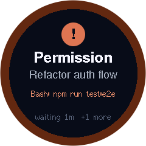
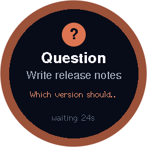
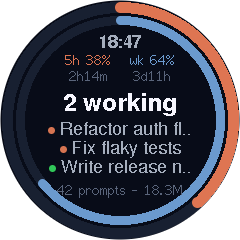
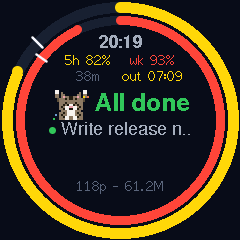
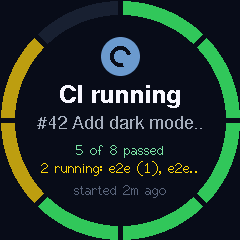
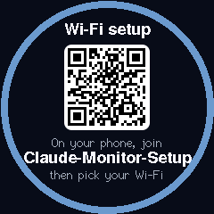
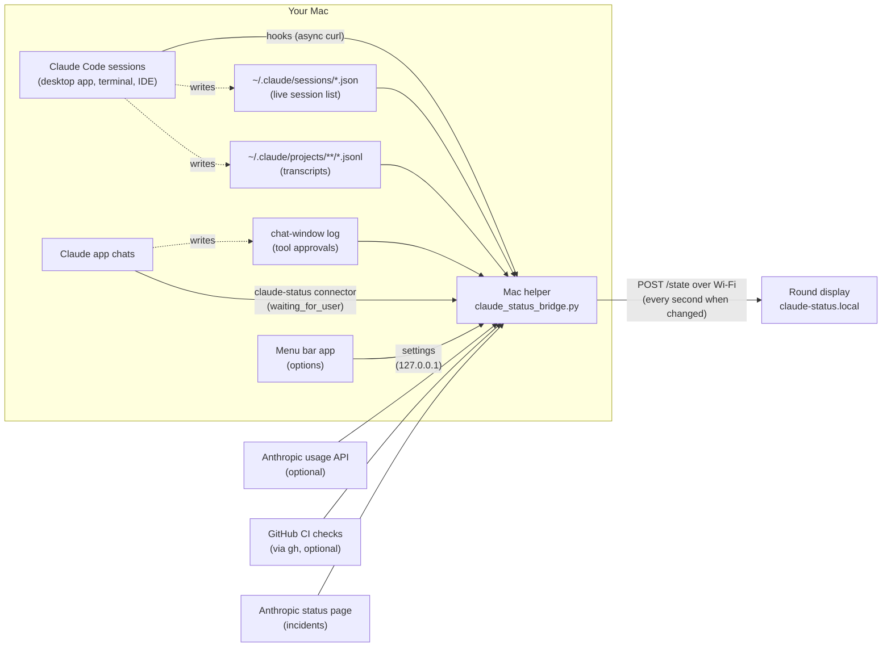
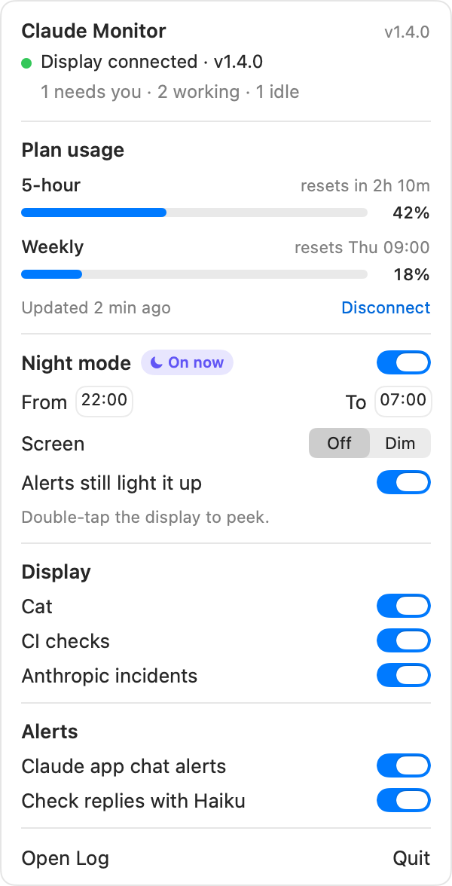
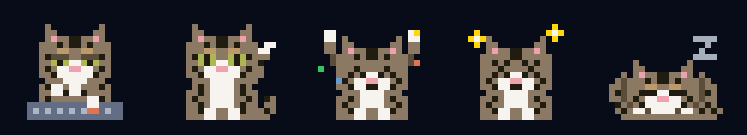
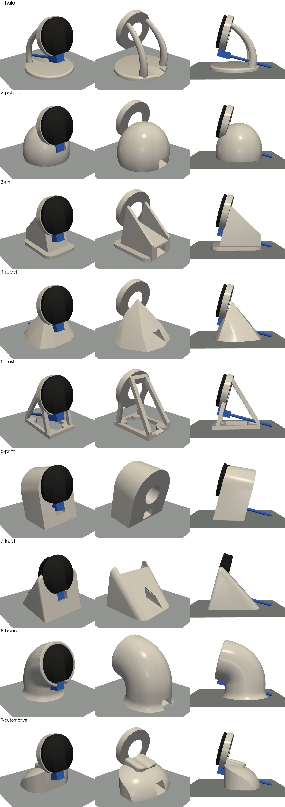

# Waveshare ESP32 Claude Monitor

A tiny round desk display that tells you what [Claude Code](https://claude.com/claude-code) is up to, and taps you on the shoulder the moment it needs you. 👋

When a session is waiting for a permission, an answer or a plan approval, the screen lights up with a pulsing orange ring so you never leave Claude sitting idle. The rest of the time it shows which sessions are working, how much of your plan you've used, and what you've got done today.

<p align="center">
  
  &nbsp;
  
  &nbsp;
  
  <br><br>
  
  &nbsp;
  
  &nbsp;
  
</p>

<p align="center"><sub>Real screenshots, grabbed straight off the device (with made-up session names).</sub></p>

<p align="center"><b><a href="#install">⬇️ Install it: three ways, easiest first</a></b></p>

---

## Contents

- [What it shows](#what-it-shows)
- [What you'll need](#what-youll-need)
- [How it works](#how-it-works)
- [Install](#install)
  - [Option 1: Let Claude set it up (easiest)](#option-1-let-claude-set-it-up-easiest)
  - [Option 2: One line in Terminal (no coding)](#option-2-one-line-in-terminal-no-coding)
  - [Option 3: Build it yourself, step by step](#option-3-build-it-yourself-step-by-step)
- [The menu bar app](#the-menu-bar-app)
- [Using a LilyGO T-RGB](#using-a-lilygo-t-rgb)
- [One display, several Macs](#one-display-several-macs)
- [Updating](#updating)
- [Reading the screen](#reading-the-screen)
- [Configuration](#configuration)
- [Troubleshooting](#troubleshooting)
- [Privacy: what it reads and where data goes](#privacy-what-it-reads-and-where-data-goes)
- [Uninstalling](#uninstalling)
- [Also in this repo](#also-in-this-repo)
- [Project layout](#project-layout)
- [Credits](#credits)

---

## What it shows

**🟠 When Claude needs you**, the whole screen becomes an alert:

- **What kind of request it is:** *Permission*, *Question*, *Plan ready* or *Needs input*
- **Which session** is asking, by name
- **What it wants**, e.g. `Bash: npm run test:e2e`, or the question Claude is asking
- **How long it's been waiting**, and how many other sessions are waiting too

The alert clears itself as soon as you respond, so you don't need to touch the device. To hide it sooner, **double-tap the case**, or click **Dismiss** in the [menu bar app](#the-menu-bar-app).

**⚪ The rest of the time**, you get a calm status screen:

- 🕐 The current time
- 🔶 **5-hour plan usage** (outer ring) and 🔷 **weekly plan usage** (inner ring), each with a countdown to its reset and a tick showing whether you're on pace
- **How many sessions are working**, plus up to three active ones, each with a status dot and how long it's been working
- 🐱 **A little tabby cat** beside the headline, acting out what's going on: typing while sessions work, waving when something needs you, cheering when they've finished, and curled up asleep when nothing's happening
- 📊 **Today's activity**: prompts sent and tokens processed, across every session
- 🔴 **Anthropic incidents**: when [Anthropic's status page](https://status.claude.com) reports a problem with Claude Code, the API or claude.ai, a red ring and the incident's name take the place of your plan usage, so you can tell when errors are on Anthropic's side

**🟢 While CI runs** on the pull request for the session you have open in the Claude app, the display shows its checks as a ring that fills in as they pass.

**🌙 At night**, [night mode](#night-mode) can turn the screen off or dim it, and still light it up when Claude needs you.

It works with every Claude Code session on your Mac: the desktop app, the terminal and IDE extensions. It can also alert you when a **regular chat in the Claude app** needs you, either to approve a connector or tool, or to answer a question Claude has asked (see [step 7](#7-optional-alerts-for-claude-app-chats)).

You change the options from a small [menu bar app](#the-menu-bar-app) on your Mac: plan usage, night mode, the cat and the rest.

---

## What you'll need

| | |
|---|---|
| 🖥️ **The display** | One of these ESP32-S3 round displays. The installers and Wi-Fi updates put the right software on each:<br>• **[Waveshare ESP32-S3-LCD-1.28](https://www.waveshare.com/wiki/ESP32-S3-LCD-1.28)**: 1.28", 240×240. The "-B" version with the CNC metal case looks great on a desk.<br>• **[Waveshare ESP32-S3-Touch-LCD-1.28](https://www.waveshare.com/wiki/ESP32-S3-Touch-LCD-1.28)**: the same display with a touch panel (which isn't used).<br>• **[LilyGO T-RGB](#using-a-lilygo-t-rgb)**: a bigger 2.1" or 2.8", 480×480 screen, where you tap the screen instead of the case. |
| 🔌 **A USB-C cable** | For flashing, and for power afterwards. Once it's set up, any USB phone charger will do. |
| 🍎 **A Mac** | Running Claude Code. The helper uses `launchd` and the macOS Keychain, and the [menu bar app](#the-menu-bar-app) needs macOS 13 or later. |
| 📶 **2.4 GHz Wi-Fi** | The ESP32 can't join 5 GHz-only networks. |
| 🌐 **Chrome or Edge** | Only to put the software on the display from your browser instead of Terminal. Safari and Firefox can't talk to USB devices. |
| 🐍 **Python 3** | For the Mac helper. macOS has it once Apple's Command Line Tools are installed; the installer offers to install them if needed. |
| 🐙 **Optional: the [GitHub CLI](https://cli.github.com)** | For the [CI card](#the-ci-card): `brew install gh`, then `gh auth login` |
| 🛠️ **[PlatformIO](https://platformio.org/install/cli)** | *Developers only*, to build the firmware yourself: `brew install platformio`. Building the menu bar app yourself also needs Xcode, or the Command Line Tools 16 or later. |
| 🖨️ **Optional: a 3D printer** | To print a [desk stand](#-stand-3d-printable-desk-stands). You'll also want a right-angle USB-C cable. Four 8 × 2 mm button magnets are optional, if you'd like to stick the stand to a metal surface. |

---

## How it works



There are three main moving parts, plus an extra for chats and the menu bar app for options:

1. **Claude Code hooks** fire on events like *permission requested*, *question asked*, *tool finished* and *turn finished*. Each hook is a tiny background `curl` that forwards the event to the helper on `127.0.0.1`. The hooks are async, so they never slow Claude down, and they quietly do nothing if the helper isn't running.
2. **The Mac helper** (`claude-status/bridge/claude_status_bridge.py`) merges three sources into one small JSON summary:
   - **the hook events**, to work out who's waiting for you
   - **`~/.claude/sessions/`**, for which sessions are open and whether each is busy or idle
   - **your transcripts**, for today's token and prompt totals

   If you turn it on, it also checks your plan usage with Anthropic. If the GitHub CLI is signed in, it asks GitHub about the checks on the pull request for the session you have open in the Claude app. Every 2 minutes it checks Anthropic's status page for incidents. It pushes the summary to the display whenever something changes, plus a heartbeat every 10 seconds.
3. **The display firmware** (`claude-status/firmware/`) joins your Wi-Fi and announces itself as `claude-status.local`. It accepts the summary on `POST /state` and draws the right screen at about 30 fps. It runs [night mode](#night-mode) by itself, so that keeps working while your Mac sleeps.
4. **Chats in the Claude app** don't have hooks, so the helper uses two other signals. It watches the app's chat-window log for **tool approval prompts**. A tiny local **connector** (`chat_mcp.py`) also gives Claude a `waiting_for_user` tool, which it calls when a reply ends with a question for you.
5. **The [menu bar app](#the-menu-bar-app)** (`claude-status/menubar/`) shows what the helper is up to and changes its settings, over the same local port. The settings themselves live in the helper.

---

## Install

There are three ways to install, easiest first:

| | Best for | You'll need |
|---|---|---|
| 🤖 **[Option 1: Let Claude set it up](#option-1-let-claude-set-it-up-easiest)** | Anyone who uses Claude Code | Claude Code: the Claude app's **Code** tab, or `claude` in a terminal |
| ⌨️ **[Option 2: One line in Terminal](#option-2-one-line-in-terminal-no-coding)** | No coding, and no Claude Code needed | Nothing else: every Mac has Terminal |
| 🛠️ **[Option 3: Build it yourself](#option-3-build-it-yourself-step-by-step)** | Developers who want to change the code | PlatformIO and a terminal |

All three need the display, a USB-C **data** cable (many charging-only cables won't work) and a Mac.

---

## Option 1: Let Claude set it up (easiest)

Claude Code does the whole setup for you, using the [setup skill](.claude/skills/setup-claude-monitor/SKILL.md) included in this project:
- it checks your Mac and installs the tools it needs
- it flashes the display and walks you through Wi-Fi on your phone
- it sets up your Mac and tests everything end to end

It stops and tells you whenever a step needs you, such as clicking **Always Allow** on a Keychain prompt.

1. **Get the project.** Download **Source code (zip)** from the [latest release](https://github.com/boujois/waveshare-esp32-claude-monitor/releases/latest) and double-click it to unzip. If you use git, you can clone it instead:
   ```bash
   git clone https://github.com/boujois/waveshare-esp32-claude-monitor.git
   ```
2. **Plug the display into your Mac** with the USB-C cable.
3. **Open the folder in Claude Code:**
   - **Claude app:** open the **Code** tab and choose the unzipped folder as the project.
   - **Terminal:** `cd` into the folder and run `claude`.
4. **Say *"set up the display"*,** or type `/setup-claude-monitor`, then follow along.

Allow about 10 minutes. Claude flashes the published firmware, the same files as Option 2, so there's nothing to build unless you ask it to build from source. The rest follows the same steps as [Option 3](#option-3-build-it-yourself-step-by-step), so you can read along there.

---

## Option 2: One line in Terminal (no coding)

No coding and nothing to install first, about 10 minutes. You paste one line into Terminal and follow along.

1. **Plug the display into your Mac** with the USB-C cable.
2. **Open Terminal** (in **Applications → Utilities**), paste this line and press **Return**:
   ```bash
   /bin/bash -c "$(curl -fsSL https://boujois.github.io/waveshare-esp32-claude-monitor/install.sh)"
   ```
3. **Follow along.** The installer:
   - **puts the software on the display** over USB. It asks first, and keeps any Wi-Fi the display already has. A display that's already on your Wi-Fi is left alone, because it gets new software over Wi-Fi.
   - **tells you when to connect the display to your Wi-Fi** from your phone ([step 2](#2-connect-the-display-to-your-wi-fi)). Carry on in Terminal meanwhile.
   - **sets up your Mac:** the background helper, the Claude Code hooks and the [menu bar app](#the-menu-bar-app) ([step 3](#3-set-up-your-mac)).
   - **waits for the display** to join your Wi-Fi. Then it switches to your Claude status.

It downloads the [latest release](https://github.com/boujois/waveshare-esp32-claude-monitor/releases/latest) from GitHub, and Espressif's `esptool` (about 60 MB, checked against a pinned checksum) to put the software on the display. To read it first: the line runs [`install.sh`](claude-status/package/web/install.sh), which runs [`Install.command`](claude-status/package/Install.command) and [`flash-display.sh`](claude-status/package/flash-display.sh) from the release.

The steps below are what the installer does, and how to do each one yourself.

### 1. Put the software on the display

The Terminal line does this for you. To use your browser instead, open the **[Claude Monitor installer](https://boujois.github.io/waveshare-esp32-claude-monitor/)** in Chrome or Edge. Plug the display into your computer, click **Install Claude Monitor**, choose the display from the list, then click **Install**. It takes about a minute.

<details>
<summary><b>The installer page doesn't open?</b> Use Espressif's web flasher instead</summary>

1. Download **`claude-monitor-firmware.bin`** from the [latest release](https://github.com/boujois/waveshare-esp32-claude-monitor/releases/latest).
2. Open [Espressif's web flasher](https://espressif.github.io/esptool-js/) in Chrome or Edge.
3. Click **Connect** and choose the display.
4. Set **Flash Address** to `0x0`, choose the `.bin` file, then click **Program**.
5. When it's done, unplug the display and plug it back in.
</details>

### 2. Connect the display to your Wi-Fi

The display now shows **Wi-Fi setup** with a QR code. On your phone, scan the code, or join the Wi-Fi network **`Claude-Monitor-Setup`**. A page pops up: pick your home Wi-Fi, type its password, and tap **Save**. The display connects and shows **"Waiting for Mac"**.

> 📶 The display only works with **2.4 GHz** Wi-Fi. If the page doesn't pop up, open `192.168.4.1` in your phone's browser.

**To change Wi-Fi later**, do any of these:
- unplug the display and plug it back in **3 times in a row**, each within 10 seconds of the last; the second time, it reminds you to do it once more
- run `curl -X POST http://claude-status.local/wifi/reset` on your Mac
- hold the **BOOT** button for 5 seconds, if your case leaves it reachable

If the display can't find its saved Wi-Fi, for example after moving house, it opens setup by itself.

### 3. Set up your Mac

The Terminal line does this too. Along the way:

1. Answer the installer's questions. It asks before restarting the Claude app.
2. For chat questions, the installer copies one sentence to your clipboard. Paste it into **Claude → Settings → Profile → personal preferences**.
3. **Optional:** click the new **Claude Monitor** icon in the menu bar, near the clock: a small circle inside a circle. Click **Connect** under **Plan usage** to show your plan usage on the display (see [step 6](#6-optional-turn-on-plan-usage-rings)), and set up [night mode](#night-mode) if you like.

Within a few seconds of the display joining your Wi-Fi, it switches to your Claude status. On macOS 12 or older there's no menu bar app, so the installer asks about plan usage itself. To remove everything later, see [Uninstalling](#uninstalling).

<details>
<summary><b>Rather not use Terminal?</b> Download the installer instead</summary>

1. Download **`Claude-Monitor-Mac.zip`** from the [latest release](https://github.com/boujois/waveshare-esp32-claude-monitor/releases/latest) and double-click it to unzip.
2. Plug the display into your Mac, unless it's already on your Wi-Fi.
3. In the **Claude Monitor** folder, double-click **`Install.command`**. macOS stops it the first time with *"Install.command" Not Opened*: click **Done**, open **System Settings → Privacy & Security**, and click **Open Anyway** next to *"Install.command" was blocked*. (On macOS 14 or older, right-click it and choose **Open** instead.)
4. From there it's the same as the Terminal line, display included. The Terminal line never sees the warning: macOS only checks files that a browser marks as downloaded, and `curl` doesn't mark them.
</details>

---

## Option 3: Build it yourself, step by step

For developers, or anyone who wants to see every step. Allow about 15 minutes. Most of that is PlatformIO downloading the ESP32 toolchain the first time.

### 1. Clone the repo

```bash
git clone https://github.com/boujois/waveshare-esp32-claude-monitor.git
cd waveshare-esp32-claude-monitor
```

### 2. Wi-Fi (optional for development)

You don't need to put your Wi-Fi details in the code: after flashing, set up Wi-Fi from your phone as in [Option 2, step 2](#2-connect-the-display-to-your-wi-fi). The display remembers it across re-flashes.

If you re-flash a lot and want to skip that step, you can pre-fill your Wi-Fi in a git-ignored `src/secrets.h`:

```bash
cp claude-status/firmware/src/secrets.h.example claude-status/firmware/src/secrets.h
```

It's only used when the board has no saved network, and release builds never include it.

### 3. Flash the display

Plug the board into your Mac with USB-C, then build and upload. PlatformIO finds the board by itself. If you have several boards plugged in, add `upload_port = /dev/cu.usbmodem…` to `platformio.ini`.

```bash
cd claude-status/firmware
pio run -t upload
```

> 🟣 **Got a LilyGO T-RGB instead?** Build its environment: `pio run -e lilygo-t-rgb -t upload`. See [Using a LilyGO T-RGB](#using-a-lilygo-t-rgb).

The first build downloads the ESP32-S3 toolchain plus the [LovyanGFX](https://github.com/lovyan03/LovyanGFX) and [ArduinoJson](https://arduinojson.org/) libraries, so give it a few minutes. When it finishes, the display shows **Wi-Fi setup**, or **"Waiting for Mac"** if it already knows your Wi-Fi. 🎉

> 💡 **Tip:** `pio device monitor` shows the board's serial log, including `Wi-Fi connected, IP …` and `mDNS: claude-status.local`.

### 4. Install the Mac helper and hooks

```bash
cd ../bridge
./install.sh
```

This does four things:

- **Starts the helper as a background service** (`~/Library/LaunchAgents/com.claude-status.bridge.plist`). It starts when you log in and restarts itself if it ever crashes.
- **Adds the hooks to `~/.claude/settings.json`**, after saving a timestamped backup next to it. Your existing settings and hooks are left as they are. Ours are tagged with `CLAUDE_STATUS` so they can be found and removed cleanly later.
- **Adds the `claude-status` connector to the Claude app** (`claude_desktop_config.json`, also backed up first) for [chat alerts](#7-optional-alerts-for-claude-app-chats). The app overwrites that file while it's running, so if the app is open, the installer skips this step and tells you to run `./install-chat-connector.sh` from **Terminal.app** instead. That script quits the Claude app, adds the connector and reopens the app; your sessions are still there afterwards.
- **Builds and installs the [menu bar app](#the-menu-bar-app)** to `~/Applications/Claude Monitor.app`, with its own background service (`com.claude-status.menubar`) so it starts when you log in. Building it needs Swift 6, which comes with Xcode or the Command Line Tools 16 or later (on macOS 14 or later). Without that, the installer skips the app, says why, and sets up everything else. To skip it anyway, run `CLAUDE_STATUS_NO_MENUBAR=1 ./install.sh`. (The downloadable installer comes with the app already built, and runs it on macOS 13 or later.)

> ℹ️ The installer finds Python by itself (Homebrew's, or the one that comes with Apple's Command Line Tools). To use a specific one, run `PYTHON=/path/to/python3 ./install.sh`.

Within a couple of seconds the display should switch from *"Waiting for Mac"* to the status screen. New Claude Code sessions pick up the hooks automatically, and most already-open sessions do too.

### 5. Try it out ✅

Ask Claude something that needs your approval, or just ask it to *"ask me a question"*. The display should light up orange straight away, and go back to normal when you answer.

### 6. (Optional) Turn on plan usage rings

The rings show your 5-hour and weekly plan limits, the same numbers as Claude Code's `/usage` screen. They're for Claude Pro and Max plans. They use the sign-in of the **terminal** `claude` command. The desktop app keeps its own separate sign-in, so you need to sign the terminal in once.

**a. Connect.** Click the Claude Monitor icon in the menu bar, then click **Connect** under **Plan usage**.

**b. Sign in, if asked.** If the terminal `claude` command isn't signed in yet, Terminal opens and runs `claude auth login`, which opens your browser. The panel says *Finish signing in in Terminal…* and carries on by itself once you're done.

**c. Allow Keychain access.** macOS will ask whether `security` can read **"Claude Code-credentials"**. Click **Always Allow**. If you click plain *Allow*, it will ask again after every restart. If you click *Deny*, the panel says so: click **Try again**, then **Always Allow**.

The rings fill in within a few seconds and refresh every 5 minutes. The panel shows the same numbers, and **Disconnect** turns plan usage off again.

<details>
<summary><b>Without the menu bar app</b></summary>

1. Sign the terminal in. This opens your browser:
   ```bash
   claude auth login
   ```
2. Add `"plan_usage": true` to `config.json` in this folder. Keep the keys already in it, especially `device_key`, the display's pairing key. This command adds the key and leaves the rest alone:
   ```bash
   python3 -c 'import json, pathlib; p = pathlib.Path("config.json"); c = json.loads(p.read_text()) if p.exists() else {}; c["plan_usage"] = True; p.write_text(json.dumps(c, indent=2) + "\n")'
   ```
3. Restart the helper, then allow Keychain access as in step c:
   ```bash
   launchctl kickstart -k gui/$(id -u)/com.claude-status.bridge
   ```
</details>

**Keeping it signed in:** the sign-in token expires every few hours. When it does, the helper asks the `claude` command to renew it by sending one tiny prompt (`ok`) on Haiku. That prompt runs with no tools, connectors, hooks or saved session, so it uses a negligible sliver of your plan. You'll see `plan usage: token renewed` in the log when it happens. If it can't renew, for example while you're offline, the panel says *Couldn't renew your Claude login (offline?)* and the helper tries again 5 minutes later. You should only need `claude auth login` again if you sign out, or if the sign-in is revoked; the panel then shows **Sign in…**.

> 🔒 The token is only ever sent to `api.anthropic.com`. The helper never refreshes, rewrites or logs it. Renewal is done by the `claude` command itself.

> 💡 **Why not a long-lived `claude setup-token` token?** We tried: Anthropic accepts those tokens but refuses them for plan usage (HTTP 403).

### 7. (Optional) Alerts for Claude app chats

Regular chats in the Claude app (the **Chat** tab, not Claude Code) can light up the display too. There are two kinds of alert.

**🔐 Tool approvals work automatically.** When a chat shows an **Allow** button for a connector or tool, the display shows **Permission → Claude chat → "Allow Weather: get_forecast?"**. There's nothing to set up.

**❓ Questions need one line in your Claude settings.** The `claude-status` connector from step 4 gives Claude a `waiting_for_user` tool. To make sure Claude uses it:

1. Make sure the connector is installed. If `install.sh` said the Claude app was running, run this from **Terminal.app**, not a terminal inside the Claude app:

   ```bash
   ./install-chat-connector.sh
   ```
2. Open **Settings → Profile**, and add this to *"What personal preferences should Claude consider in responses?"*:

   > When a reply ends with a question for me, or you need me to choose or decide something before you can continue, call the claude-status `waiting_for_user` tool as the last step, with a short version of the question and a 2-5 word title for the chat.

3. The first time Claude calls it, choose **Always allow**.

The display then shows **Question → *chat title* → *the question***.

**How chat alerts clear:** the app doesn't report when you've answered, so a chat alert clears in any of these cases:
- when you **switch to the Claude app**
- after the app has been **in front for 30 seconds**, if you were already in it
- when the chat's **next tool runs** without needing approval (approval alerts only)
- **after 10 minutes**, as a backstop

To turn chat alerts off, switch off **Claude app chat alerts** in the menu bar app.

> ⚠️ **Good to know:**
> - Question alerts rely on Claude choosing to call the tool. That's usually reliable, but not guaranteed.
> - Tool approvals are read from the app's internal log, so an app update could quietly change or break them.
> - Neither works for claude.ai open in a web browser.

---

## The menu bar app



Claude Monitor puts a small icon in your Mac's menu bar, near the clock: a **circle inside a circle**. It turns into a **moon** during night mode hours, and a **dashed circle** when the Mac helper isn't running.

Click it for:

- **Status:** whether the display is connected, and which firmware it runs; your sessions, e.g. *1 needs you · 2 working*; any Anthropic incident; and an **Update to v1.x.x…** button when there's a new release.
- **What's on the display:** the alert, Done card or CI card on its screen, with an **Open** button that brings up the app that session runs in (see [Jump to the session](#jump-to-the-session)) and a **Dismiss** button that hides it just like a double tap. These need display firmware newer than v1.5.0 (see [Updating](#updating)); Open needs a newer one still.
- **Plan usage:** **Connect**, then your 5-hour and weekly usage and when each resets. **Disconnect** turns it off. See [step 6](#6-optional-turn-on-plan-usage-rings).
- **Night mode:** on or off, **From** and **To** times, **Screen** *Off* or *Dim*, and **Alerts still light it up**. See [Night mode](#night-mode).
- **Display:** switches for **Cat**, **CI checks** and **Anthropic incidents**.
- **Alerts:** switches for **Claude app chat alerts** and **Check replies with Haiku**.
- **Open Log** and **Quit**.

Changes are saved in the helper's [`config.json`](#configuration) and take effect within a second, without restarting anything. If the helper isn't running, the panel says so and offers **Start helper**.

**Can't see the icon?** A full menu bar, or the notch on a MacBook, can hide it. Open **Claude Monitor** from the Applications folder in your home folder, or find it with Spotlight: the same options open in a window. Closing the window only hides it.

The installer puts the app in `~/Applications` and starts it when you log in. **Quit** keeps it closed until you next log in, or until you open it again from `~/Applications`. It needs macOS 13 or later. Everything else works without it, and you can still change the options in [`config.json`](#configuration).

<br clear="right">

---

## Using a LilyGO T-RGB

The firmware also runs on the [LilyGO T-RGB](https://www.lilygo.cc/products/t-rgb) (ESP32-S3 with a 480×480 round RGB screen), both the 2.1" (half- or full-circle touch) and the 2.8". The UI is the same one, drawn at 240×240 and scaled up 2× with smoothing. The T-RGB has no motion sensor, so the case taps are **taps on the screen** instead: tap a card once to [jump to its session](#jump-to-the-session) on your Mac, double-tap to dismiss it, or tap 5 times for diagnostics. The **BOOT** button works as described above.

It installs and updates like the Waveshare: the one-line installer, `Install.command` and the [installer page](https://boujois.github.io/waveshare-esp32-claude-monitor/) all put the right software on it (the installers tell the boards apart by their memory; on the page, pick **LilyGO T-RGB**), and the menu bar app's **Update** button updates it over Wi-Fi with the T-RGB build from each release.

To build it yourself instead: `cd claude-status/firmware && pio run -e lilygo-t-rgb -t upload`. If the upload can't find the board, hold **BOOT**, tap **RST**, release **BOOT**, and run it again. A build from source reports version `dev`, so the menu bar app doesn't offer it updates until you install a release.

Some T-RGB panels show mixed colours too blue, so the T-RGB build turns blue and green down a little (white balance red 100%, green 90%, blue 70%). Adjust it live from your Mac, and it's saved on the display:
```bash
curl -X POST "http://claude-status.local/whitebalance?r=100&g=90&b=70"
```
To change how bright the normal screens are (alerts are always full brightness), use `curl -X POST "http://claude-status.local/brightness?level=100"` (percent; it starts at 80% on a T-RGB).

[Night mode](#night-mode) and the other options work the same as on the Waveshare, from the [menu bar app](#the-menu-bar-app): at night, double-tap the screen to peek.

`curl http://claude-status.local/whitebalance` shows the current values; `r=100&g=100&b=100` turns the correction off.

The screen type is detected from the touch controller at start-up, but the newer revision of the 2.1" board (V2) can't be told apart from the original, so it gets the original's settings. If the screen is blank, tinted or the colours look wrong, force the type by adding e.g. `-DTRGB_PANEL=LILYGO_T_RGB_2_8_INCHES` (or `LILYGO_T_RGB_2_1_INCHES_FULL_CIRCLE`, `…_HALF_CIRCLE`, `…_FULL_CIRCLE_V2`, `…_HALF_CIRCLE_V2`) to `build_flags` in the `lilygo-t-rgb` environment.

Each board only accepts Wi-Fi updates built for it (`/info` reports which board it is), so one can't be sent the other's software by mistake. The panel driver in `claude-status/firmware/src/trgb/` is LilyGO's, under its MIT licence.

---

## One display, several Macs

One display can show up to four Macs at once, such as a desktop and a laptop. Install the Mac helper on each one (any of the [install options](#install), skipping the flashing step on the second Mac) and point them all at the same display. That's all: each helper tells the display which Mac it is, and the display merges them.

- **Alerts:** a session on any Mac that needs you lights the display, and the one waiting longest is shown first, whichever Mac it's on.
- **Status screen:** the session list and counts cover every Mac. Today's prompts and tokens add up across them. The plan usage rings come from the first Mac with plan usage turned on.
- **Jump to the session:** a tap on a card opens the session on the Mac it's running on. The other Macs ignore it.
- **Settings:** the cat, night mode and timezone follow the first Mac that connected, while it's still pushing. If it goes to sleep, the next one takes over.
- **Mac offline** only shows once every Mac has gone quiet for 30 seconds. A Mac that's asleep drops off the display within about 10 seconds of that, and its place is freed after 10 minutes.
- **Updates over Wi-Fi** come from the Mac the display paired with first, so use its menu bar app to update. See [Updating](#updating).

Each Mac goes by its local hostname (**System Settings → General → Sharing**). Two Macs with the same name would count as one, so give them different names, or set `source_name` in [`config.json`](#mac-helper-configjson). The display's status page (`http://claude-status.local/`) lists the Macs it's hearing from.

A display needs firmware from this version or later to merge Macs; older firmware shows whichever Mac pushed last. Helpers from before this version still work, and all count as one Mac.

---

## Updating

When a new version comes out, the display's footer alternates with **"Update: v1.x.x"**, and the menu bar panel shows an **Update to v1.x.x…** button. The helper checks GitHub once a day. To update, do any of these:

- **Click Update to v1.x.x…** in the [menu bar app](#the-menu-bar-app). It opens Terminal and runs the updater.
- **Ask Claude Code** *"update my Claude monitor"*. The installer adds an `update-claude-monitor` skill to Claude Code, so this works in any session.
- **Run the [install line](#option-2-one-line-in-terminal-no-coding) again:** it installs the latest release over the top, keeping your settings. It only updates a display that's plugged in over USB and not on your Wi-Fi; otherwise use one of the other ways.
- **Double-click** `Update.command` from the Mac zip. macOS asks you to allow it the first time, as with `Install.command`.
- **Run** `"$HOME/Library/Application Support/Claude Monitor/update.sh"` in a terminal. Add `--check` to only see the versions.

It updates the Mac helper and the menu bar app, keeping your settings, and sends the new firmware to the display **over Wi-Fi**. No cable is needed; the display shows a progress ring and restarts by itself, lighting up for it even during night mode. Updating from a version without the menu bar app installs it. Only one update runs at a time; a second one says *An update is already running in another Terminal window.*

> 🔐 **Pairing:** the first time the helper finds the display, they pair with a random key. After that, only your Mac can update the display. To pair with a different Mac, power the display on 3 times in a row, each within 10 seconds of the last. That resets its Wi-Fi and pairing.

> ⚠️ **Coming from v1.0.x?** Older displays can't update over Wi-Fi yet, and older Mac installs don't have `update.sh`. Do one last manual update: plug the display into your Mac and run the [install line](#option-2-one-line-in-terminal-no-coding) again. It puts the new software on over USB and keeps your Wi-Fi. (Re-flashing from the [installer page](https://boujois.github.io/waveshare-esp32-claude-monitor/) works too.) Every update after that is automatic.

---

## Reading the screen

### The status screen


From top to bottom:

- **Rings:** the outer 🔶 ring is your 5-hour plan usage and the inner 🔷 ring is weekly usage. They fill clockwise from 12 o'clock. The small white **tick** on each ring shows how much of that window has gone by. If the coloured arc is past its tick, you're using your plan faster than it lasts. While Anthropic has an incident affecting Claude Code, the API or claude.ai, the usage rings make way for a pulsing **red** ring, and *Anthropic incident* shows where the usage numbers were, with the incident's name scrolling underneath, e.g. *Elevated errors for Claude Opus 5.5*. Red error dots are then most likely Anthropic's problem, not yours.
- **Time:** the current time, kept in sync over the internet (NTP). If your network blocks time servers, the display takes the time from your Mac instead.
- **`5h 38%` / `wk 64%`:** the same usage as numbers, with the time left until each limit resets underneath. When you're ahead of the tick, it shows in yellow when you'd run out at this pace instead: `out 16:40`, or `out Fri` for the weekly limit.
- **Headline**, with [the cat](#the-cat) acting it out beside it:
  - **`2 working`:** sessions are busy
  - **`All done`** (green): sessions have finished; you'll usually see the green Done card instead
  - **`All idle`:** nothing is happening
  - **`1 waiting`** (pulsing orange): you dismissed an alert, but something still needs you
- **Session list:** up to three active sessions, each with a dot (see the colour guide below). Working sessions show how long they've been working, e.g. `12m`.
- **Footer:** today's prompt count and total tokens processed, across all sessions.

<br clear="right">

### The cat

<p align="center"></p>

A brown tabby sits beside the headline on the status screen and acts out what your sessions are up to:

| The cat is… | When |
|---|---|
| ⌨️ **Typing** | Sessions are working (`2 working`). The more there are, the faster it types. |
| 👋 **Waving** | Something still needs you after you hid its alert (`1 waiting`) |
| 🎉 **Cheering** | Sessions have finished and you haven't replied yet (`All done`) |
| 💫 **Seeing stars** | A session's last turn ended with an API error, and nothing is working or waiting |
| 💤 **Asleep** | Nothing is happening (`All idle`), or the display hasn't heard from your Mac |

When the display powers on, the cat walks across the empty screen before anything else appears.

Prefer the plain status screen? Switch off **Cat** in the [menu bar app](#the-menu-bar-app), or set `"cat": false` in the helper's `config.json` (see [Configuration](#configuration)). The display remembers it, so the walk at power-on stops too.

### The alert screen


| Headline | Badge | Shown when… |
|---|---|---|
| **Permission** | `!` | Claude wants to run a tool that needs your approval |
| **Question** | `?` | Claude is asking you a multiple-choice question, or its reply ends waiting on you: a question (*"Want me to push it?"*), a request (*"After you approve, I'll create the ticket"*), or a step for you to do (*"Run it on staging and paste the output"*) |
| **Plan ready** | `!` | Claude has finished a plan and wants you to review it |
| **Needs input** | `!` | an MCP server or agent needs something from you |

If several sessions are waiting, the one that has waited longest is shown, and the footer says `+N more`.

**Want it to go away?** Double-tap the case: two quick, firm taps with a fingertip, anywhere on the case. A short press of the **BOOT** button does the same, if your case leaves it reachable. That hides the alert until a *new* request comes in, and the status screen then shows `N waiting` in orange instead. **Dismiss** in the [menu bar app](#the-menu-bar-app) does the same from your Mac.

Double tap uses the board's built-in motion sensor. Typing, putting a mug down or knocking on the desk doesn't set it off, and neither does picking the display up.

<br clear="right">

### Jump to the session

To answer an alert, you need the session that's asking. **Open** in the [menu bar app](#the-menu-bar-app), or a single tap on the card on a LilyGO T-RGB's touch screen, brings it up on your Mac:

- **Terminal or iTerm2:** the app comes forward on the tab running that session. The first time, macOS asks whether the Claude Monitor helper (python3) may control the app: click **OK**.
- **VS Code, Cursor, Windsurf:** the window with that session's folder comes forward.
- **The Claude app's Code tab:** the app comes forward on that session. **A chat in the Claude app:** the app comes forward.
- **Anything else:** the app it runs in comes forward. Sessions in `tmux` or over `ssh` aren't in an app, so nothing opens.

The T-RGB shows *Opening on your Mac* when you tap. The Waveshare boards' taps are on the case, where a single one is too easy to set off by accident, so they use the menu bar app.

### The Done card

When a Claude Code session finishes and doesn't need anything from you, the display shows a green **Done** card: a ✓, the session's name, a one-line summary of what it did (from the [reply check](#how-replies-that-need-you-are-spotted)), and how long ago it finished. The card stays until you send that session another message, so you can see at a glance that a task is finished. If several sessions have finished, the most recent is shown with `+N more`.

The card goes away when:
- **you reply** to that session
- **you look at it:** open that session in the Claude app, with the app in front
- **you were already watching:** if the session finishes while it's open in front of you, no card appears
- **you double-tap the case** (or press **BOOT**, or click **Dismiss** in the menu bar app): the sessions on the card stay hidden, and a session that finishes later still gets its own card

A quick acknowledgement like *"thanks"*, *"ok"* or 👍 doesn't bring the card back when Claude answers it.

Needs-input alerts always come first. If you'd rather finished sessions faded back to the status screen after a while, set `done_window` in `config.json`, for example `900` for 15 minutes.

### The CI card


When the session you have open in the Claude app is on a branch with an open pull request, the display shows that pull request's checks. The ring has one segment per check and fills clockwise as they pass: 🟢 passed, 🔴 failed, 🟡 running (pulsing), dark for queued and grey for cancelled. Checks that were skipped are left out. Underneath, it says how many have passed, which ones are running or failed, and when the run started or finished.

It follows the session you last opened in the Claude app, so it stays up while you switch to another app to wait. A question or permission request from **another** session still comes first. The CI card then comes before the open session's own requests, which you can see in the app anyway, and before Done cards.

Passed checks stay on screen for 10 minutes, then the status screen comes back (`ci_passed_window` in `config.json`). Failed checks stay until you push again. Double-tap, or click **Dismiss** in the menu bar app, to hide the card until the checks change.

The helper asks GitHub with the [GitHub CLI](https://cli.github.com) (`gh`), every 15 seconds while checks run and every minute otherwise, so `gh` needs to be installed and signed in. Sessions in the terminal or an IDE don't get a CI card: only the Claude app tells the helper which session you have open. To turn the CI card off, switch off **CI checks** in the menu bar app.

<br clear="right">

### Night mode

Night mode turns the screen off, or dims it right down, between two times you choose, such as 22:00 to 07:00. Turn it on in the [menu bar app](#the-menu-bar-app):

- **From** and **To** are in 24-hour time, by your Mac's clock. The hours can run past midnight.
- **Screen: Off** turns the backlight off. **Dim** leaves it just bright enough to glance at.
- **Alerts still light it up:** a session that needs you still lights the screen, a little less brightly than by day. Done and CI cards stay dark. If the session you have open in the Claude app needs you, its alert shows instead of its CI card, which comes back, dark, once you dismiss the alert. Switch this off for a fully dark night.
- **Peek:** double-tap the case, or press **BOOT**, while the screen is off or dimmed, and it lights up for 15 seconds. That tap only lights the screen; it doesn't dismiss anything. While it's lit, a double tap dismisses the card on screen as usual, and keeps the screen lit for another 15 seconds.

The five-tap diagnostics, Wi-Fi setup and firmware updates also light the screen at night. The display goes dark again afterwards, even if it restarted.

The display keeps the schedule itself, so night mode keeps working while your Mac is asleep or switched off. It does need to know the time, from a time server or from your Mac; until then, it's always day. While it's night, the menu bar icon turns into a moon and the panel says **On now**.

Night mode needs a display firmware that has it. If the panel says *Update the display to use night mode*, [update](#updating) the display. Your night mode settings are saved meanwhile.

### How replies that need you are spotted

When a Claude Code turn ends, the helper reads Claude's final message:

1. **Phrase check.** If the message ends with a question, or a request like *"after you approve"*, *"please confirm"*, *"should I…"* or *"over to you"*, the display shows a **Question** alert straight away.
2. **Haiku check.** If the phrases don't catch it, the helper asks Claude Haiku, through the terminal `claude` command, whether the message is waiting on you, and gets a one-line summary for the display. Each check takes a few seconds and uses a sliver of your plan.

The Haiku check needs the terminal `claude` command to be signed in, the same as the [plan usage rings](#6-optional-turn-on-plan-usage-rings). Without that sign-in, only the phrase check runs. To turn the Haiku check off, switch off **Check replies with Haiku** in the menu bar app, or set `"check_replies": false` in `config.json`. When the helper starts, it also checks idle sessions from the last 24 hours, so nothing is missed after a restart.

### Colour guide

| Colour | Meaning |
|---|---|
| 🟠 Orange dot (pulsing) | Session is working |
| 🟠 Orange dot (solid) | Session is waiting for you |
| 🟢 Green card / dot | Session finished, and you haven't replied to it yet |
| 🔴 Red dot | Session's last turn ended with an API error |
| 🟡 Yellow ring | Usage is 75% or more |
| 🔴 Red ring | Usage is 90% or more. Time to pace yourself! |
| ⚪ White tick on a usage ring | How much of that window has gone by. Usage past its tick will run out before the reset. |
| 🟡 `out 16:40` | When you'd run out at your current pace |
| 🟢 🔴 🟡 Ring segments | CI checks passed, failed or running, on the [CI card](#the-ci-card) |
| 🔴 Red ring (pulsing) instead of the usage rings | Anthropic has an incident affecting Claude Code, the API or claude.ai |

### Other screens

- **Waiting for Mac:** the display has never heard from the helper since it powered on. It shows its IP address and `claude-status.local` to help with debugging.
- **Mac offline:** nothing has arrived for 30 seconds. Your Mac might be asleep, or the helper might have stopped. The cat naps on both of these screens until the Mac is back.
- **Wi-Fi setup:** the display has no saved Wi-Fi, or can't reach it. Join `Claude-Monitor-Setup` from your phone. See [Option 2, step 2](#2-connect-the-display-to-your-wi-fi) for how to bring this screen back to change networks.
- **Diagnostics:** tap the case **5 times** quickly. It shows the firmware version, the Wi-Fi network and its signal strength, the IP address and name, when the Mac last sent an update, and how long the display has been on. The ring counts down for 30 seconds, then it closes by itself. Double-tap to close it sooner. It shows at normal brightness, even during night mode.

---

## Configuration

### Mac helper: `config.json`

The helper keeps its settings in `config.json`, next to it: `~/Library/Application Support/Claude Monitor/config.json`, or `claude-status/bridge/config.json` if you installed from a git checkout, where it's git-ignored.

The [menu bar app](#the-menu-bar-app) changes `plan_usage`, `cat`, `ci_checks`, `status_page`, `chat_alerts`, `check_replies` and the `night_` settings while the helper runs. It saves them here, and they take effect straight away.

To change anything else, edit the file and restart the helper. All keys are optional. Keep the ones already there, especially `device_key`, the display's pairing key, which the helper adds by itself. On/off settings must be `true` or `false`; anything else, such as `"false"` or `0`, counts as the default.

```bash
launchctl kickstart -k gui/$(id -u)/com.claude-status.bridge
```

| Key | Default | What it does |
|---|---|---|
| `device_host` | `"claude-status.local"` | Hostname or IP of the display |
| `source_name` | this Mac's local hostname | This Mac's name on the display, when [several Macs share it](#one-display-several-macs) |
| `plan_usage` | `false` | Fetch 5-hour/weekly plan usage (see [step 6](#6-optional-turn-on-plan-usage-rings)) |
| `plan_usage_interval` | `300` | Seconds between plan usage checks |
| `push_interval` | `1.0` | How often (seconds) the helper checks for changes |
| `heartbeat_interval` | `10` | Push at least this often (seconds), even if nothing changed |
| `done_window` | `0` | How long (seconds) a finished session shows as done (the green card). `0` keeps it until you reply |
| `chat_alerts` | `true` | Alert on Claude app chats (tool approvals and connector questions) |
| `check_replies` | `true` | When a Claude Code reply doesn't obviously ask for anything, ask Haiku whether it's waiting on you (see [How replies that need you are spotted](#how-replies-that-need-you-are-spotted)) |
| `ci_checks` | `true` | Show the [CI card](#the-ci-card) for the session you have open in the Claude app. Needs the GitHub CLI (`gh`), signed in |
| `ci_passed_window` | `600` | How long (seconds) checks that passed stay on screen. `0` keeps them while the session is open |
| `status_page` | `true` | Check [Anthropic's status page](https://status.claude.com) every 2 minutes, and turn the ring red during incidents affecting Claude Code, the API or claude.ai |
| `cat` | `true` | Show [the cat](#the-cat). `false` brings back the plain status screen, and the display stops walking the cat across at power-on |
| `night_mode` | `false` | Turn the screen off or dim it overnight (see [Night mode](#night-mode)) |
| `night_start` | `"22:00"` | When night starts: 24-hour `"HH:MM"`, by your Mac's clock |
| `night_end` | `"07:00"` | When night ends. Earlier than `night_start` runs past midnight; the two can't be the same |
| `night_screen` | `"off"` | `"off"` turns the screen off at night; `"dim"` keeps it very dim |
| `night_alerts` | `true` | A session that needs you still lights the screen at night |
| `listen_port` | `47823` | Local port for hooks, the chat connector and the menu bar app. If you change it, also update the URL in `hooks.py` and `chat_mcp.py`, then re-run `install.sh`, which passes the new port to the menu bar app |

### Firmware: top of `claude-status/firmware/src/main.cpp`

| Setting | Default | What it does |
|---|---|---|
| `HOSTNAME` | `"claude-status"` | mDNS name: the display is reachable at `<HOSTNAME>.local` |
| `SETUP_AP` | `"Claude-Monitor-Setup"` | Name of the Wi-Fi setup network |
| `DEFAULT_TZ` | `"UTC0"` | Timezone until the Mac helper connects. After that, the display uses your Mac's timezone automatically. |
| `STALE_MS` | `30000` | How long (ms) without an update before showing *Mac offline* |
| `TAP_G` | `0.25` | How firm each tap on the case must be, in g. Raise it if knocks on your desk dismiss alerts; lower it if your taps are missed. |
| `DIAGNOSTICS_MS` | `30000` | How long (ms) the diagnostics screen stays up after 5 quick taps |
| Brightness | `150` / `255` | Status screen / alert brightness. They're in `night.h`, with night mode's levels: alerts `150`, peek `80` for 15 s, and dim `10` |

Re-flash after changing anything with `pio run -t upload`.

---

## Troubleshooting

<details>
<summary><b>The display is stuck on "Waiting for Mac"</b></summary>

1. Is the helper running? `launchctl print gui/$(id -u)/com.claude-status.bridge | grep state` should say `running`.
2. Check its log: `tail -20 ~/Library/Logs/claude-status-bridge.log`. Look for `pushing to claude-status.local (192.168.x.x)`.
3. If it says `cannot resolve claude-status.local`, mDNS isn't getting through your network. Set `"device_host"` in `config.json` to the IP address shown on the display. A DHCP reservation in your router keeps that IP from changing.
4. Make sure your Mac and the display are on the same network. Guest networks often block devices from seeing each other.
</details>

<details>
<summary><b>Claude is waiting but the display doesn't alert</b></summary>

1. Check the hooks are installed: `jq '.hooks | keys' ~/.claude/settings.json` should list `PermissionRequest`, `PreToolUse`, `Notification` and the others.
2. Check events are arriving: `curl -s http://127.0.0.1:47823/state | jq .hook_events_seen` should increase as you use Claude.
3. The helper logs every change to who's waiting, e.g. `9a8ac88a PermissionRequest: waiting - -> ['perm']`.
4. Sessions that were already open before you installed may need restarting to pick up the hooks.
</details>

<details>
<summary><b>An alert won't go away</b></summary>

Alerts clear when the tool finishes, when you send a new prompt, or when Claude's turn ends. If you deny a permission and Claude stops quietly, the alert clears when that turn ends. You can also double-tap the case to dismiss it, press **BOOT** if your case leaves the button reachable, or click **Dismiss** in the menu bar app.
</details>

<details>
<summary><b>Double-tapping doesn't dismiss anything</b></summary>

1. Tap the metal case twice with a fingertip, firmly, with the second tap within about half a second of the first. Stop at two: three or four taps in a row don't count. It works on the alert, the CI card and the Done card; the status screen ignores it.
2. Open `http://claude-status.local/` in a browser. `taps seen` counts the double taps and 5-tap runs the display noticed. If it says `no motion sensor`, your board doesn't have one, or it isn't answering.
3. If light taps are missed, or knocks on your desk count, change `TAP_G` in the [firmware settings](#configuration) and re-flash.
</details>

<details>
<summary><b>The CI card doesn't appear</b></summary>

1. It only shows for the session you have open in the **Claude app**, not the terminal or an IDE, and only while that session's branch has an **open** pull request with checks.
2. Passed checks stay for 10 minutes after they finish. To keep them up while the session is open, set `"ci_passed_window": 0` in `config.json`.
3. In that session's folder, `gh pr view --json statusCheckRollup` should list the checks. If `gh` isn't installed, run `brew install gh`. If it says you aren't signed in, run `gh auth login`.
4. The helper logs each change, e.g. `CI #1252 Fix the login form: running PPPRRQ`.
</details>

<details>
<summary><b>The ring is red and my usage is gone</b></summary>

Anthropic's [status page](https://status.claude.com) is reporting an incident that affects Claude Code, the Claude API or claude.ai; its name scrolls under *Anthropic incident* at the top of the status screen. The ring goes back to normal once Anthropic marks the incident resolved. Incidents that only affect other services, such as the Console, don't count. If the helper can't reach the status page for 10 minutes, it stops showing the incident, so a problem with your own connection isn't blamed on Anthropic. To stop showing incidents, switch off **Anthropic incidents** in the menu bar app.
</details>

<details>
<summary><b>The usage rings are empty</b></summary>

- Open the [menu bar app](#the-menu-bar-app): **Plan usage** says what's wrong.
  - **Sign in to Claude in Terminal:** click **Sign in…**, or run `claude auth login` in a terminal.
  - **macOS didn't allow access to "Claude Code-credentials" in the Keychain**, or **The Keychain didn't answer in time:** click **Try again**, then **Always Allow** when macOS asks. Otherwise the helper only asks again every 5 minutes.
  - **Couldn't renew your Claude login (offline?):** the helper tries again in 5 minutes. If it keeps failing, check that `claude -p ok` works in a terminal.
  - **Install Claude Code's terminal CLI:** the helper can't find the `claude` command. Install Claude Code's terminal command, then click **Try again**.
- Without the menu bar app: is `plan_usage` set to `true` in `config.json`? Did you restart the helper afterwards? `tail ~/Library/Logs/claude-status-bridge.log` shows the same messages, e.g. `plan usage: signed out - Sign in to Claude in Terminal`.
- Plan usage is only available for Claude Pro and Max subscriptions.
</details>

<details>
<summary><b>I can't find the menu bar icon</b></summary>

- A full menu bar, or the notch on a MacBook, can hide it. Open **Claude Monitor** from the Applications folder in your home folder, or find it with Spotlight. The same options open in a window.
- If you clicked **Quit**, it stays closed until you next log in, or until you open it again from `~/Applications`.
- Not in `~/Applications`? The installer skipped it and said why: it needs macOS 13 or later, and installing from a git checkout needs Swift 6. Its log is `~/Library/Logs/claude-monitor-menubar.log`.
</details>

<details>
<summary><b>The menu bar app says the helper isn't running</b></summary>

Click **Start helper**. If it doesn't start, **Open Log** shows why, and running the installer again sets it up again: the [install line](#option-2-one-line-in-terminal-no-coding), or `install.sh` from a git checkout.
</details>

<details>
<summary><b>Night mode doesn't darken the screen</b></summary>

1. If the menu bar app says *Update the display to use night mode*, the display's firmware is older than night mode. [Update it](#updating).
2. Check the times: they're 24-hour, by your Mac's clock. The panel says **On now** while it's night.
3. A session that needs you still lights the screen, unless you switch off **Alerts still light it up**.
4. Open `http://claude-status.local/` in a browser. The night mode line shows the hours the display has, whether it's night there (`on now`) and the backlight level. Until the display knows the time, it's always day.
</details>

<details>
<summary><b>Chat alerts don't appear</b></summary>

- **Questions:**
  - Check that `claude-status` appears in the chat's connectors (search and tools) menu. If it doesn't, run `./install-chat-connector.sh` from Terminal.app. Editing the config while the app is open doesn't stick.
  - Is the line in your personal preferences? Try asking a chat to *"ask me a question"*.
  - The helper logs `chat: question from …` when the tool is called.
- **Tool approvals:** the helper logs `chat: approval needed for …`. If that never appears, an app update may have changed the log format.
</details>

<details>
<summary><b>Colours look wrong, or the screen is blank</b></summary>

- **Inverted colours** (white background): flip `cfg.invert` in the `LGFX` class in `main.cpp`.
- **Blank screen:** the software may be for the other Waveshare version. The touch version (ESP32-S3-Touch-LCD-1.28) uses different reset and backlight pins (RST 14, BL 2). Install again and answer **yes** when asked about a touch screen (or pick it on the installer page), or build it with `pio run -e waveshare-s3-touch-lcd128 -t upload`.
</details>

<details>
<summary><b>Upload fails with "port is busy" or "no serial data received"</b></summary>

Close anything else using the serial port, such as `pio device monitor` or the Arduino IDE. If it still won't connect, hold **BOOT**, tap **RESET**, release **BOOT**, then upload again.
</details>

### Handy debugging tools 🔧

| What | How |
|---|---|
| See exactly what the helper is sending | `curl -s http://127.0.0.1:47823/state \| jq` |
| The settings and status the menu bar app sees | `curl -s http://127.0.0.1:47823/settings \| jq` |
| One-off snapshot without the service | `python3 claude-status/bridge/claude_status_bridge.py --once` |
| Screenshot of the display | Open `http://claude-status.local/screen.bmp` in a browser |
| Display's own status page, including the taps it has seen and night mode | `http://claude-status.local/` |
| Diagnostics on the display itself: version, Wi-Fi, IP | Tap the case 5 times quickly |
| Helper log | `tail -f ~/Library/Logs/claude-status-bridge.log` |
| Menu bar app log | `tail ~/Library/Logs/claude-monitor-menubar.log` |

---

## Privacy: what it reads and where data goes

It's your Claude activity, so here's exactly what this project touches:

- **Hooks** send event data (session ID, tool name and tool input such as the command being run) **only to `127.0.0.1`**, the helper on your own Mac.
- **The helper reads** `~/.claude/sessions/` (session names and busy/idle state) and your transcript files in `~/.claude/projects/` (token counts and prompt *counts* only; it doesn't keep your messages).
- **The display receives** your Mac's local hostname, session names, short details such as `Bash: npm test`, counts and usage percentages, your night mode hours and your Mac's clock, over your local Wi-Fi.
- **The helper's local API**, which the hooks, the chat connector and the menu bar app use, only listens on `127.0.0.1`, so nothing else on your network can reach it. It also turns away requests from web pages: it refuses any request with an `Origin` header, which browsers add, or with a `Host` other than `127.0.0.1` or `localhost`, which stops a website pointing its own name at your Mac (DNS rebinding). It never hands out the display's pairing key or your Claude sign-in.
- **Chat alerts:** the helper reads the Claude app's chat-window log (`~/Library/Logs/Claude/claude.ai-web.log`), but only the tool approval lines, which contain a tool name. The connector sends the short question and chat title Claude gives it to the helper on `127.0.0.1`, and from there to the display.
- **Reply checks:** when a Claude Code turn ends without an obvious question, the last 3,000 characters of Claude's reply are sent to Claude Haiku, through your own `claude` sign-in, to ask whether it's waiting on you. Turn this off with `"check_replies": false`.
- **Plan usage (opt-in only, with Connect in the menu bar app)** reads the terminal `claude` login's token from your Keychain and sends it **only to `api.anthropic.com`**. When the token expires, the helper runs one tiny `claude -p ok` request so the CLI renews it.
- **CI checks:** for the session you have open in the Claude app, the helper runs `gh pr view` in that session's folder, which asks **GitHub** about the branch's pull request using your own `gh` sign-in. The display gets the pull request's number and title, and the names and results of its checks. Turn this off with `"ci_checks": false`.
- **Anthropic's status page:** every 2 minutes the helper downloads the public summary from `status.claude.com`. The request carries nothing about you or your sessions. Turn this off with `"status_page": false`.
- **Nothing else leaves your Mac.** There's no telemetry, cloud service or account.

- **Updates:** the helper checks GitHub's public API for the latest release once a day. Firmware updates only go from your Mac to the display, using the pairing key in `config.json`.

> ⚠️ Apart from firmware updates, which need the pairing key, the display's web endpoints have no password. Anyone on your local network could read the screenshot, push fake status to it or reset its Wi-Fi. That's fine on a home network, but think twice on shared or office Wi-Fi.

---

## Uninstalling

If you installed with the Terminal line or `Install.command`, run this in Terminal:

```bash
"$HOME/Library/Application Support/Claude Monitor/Uninstall.command"
```

`Uninstall.command` from the Mac zip does the same, and so does `./claude-status/bridge/uninstall.sh` from a git checkout.

This stops and removes the background service and the menu bar app (`~/Applications/Claude Monitor.app` and its log), takes our hooks back out of `~/.claude/settings.json`, removes the `claude-status` connector from the Claude app and the `update-claude-monitor` skill. It saves backups first, and leaves your other hooks and connectors alone. The display then shows *Mac offline* until you re-flash it with something else.

Also remove the `waiting_for_user` line from your Claude personal preferences. To sign the terminal out as well, run `claude auth logout`.

---

## Also in this repo

### 🖨️ `stand/`: 3D-printable desk stands

Desk stands for the CNC-cased display, ready to print. They all hold the screen at the same 75° angle and height, and all leave room for a **right-angle USB-C cable**: the plug sits under the case and the cable runs back through the stand and out of the back.

**Nine designs** live in `stand/designs/`. They all use the same ring position, angle and cable route, so any of them fits the same way:

| Design | Style | Printing |
|---|---|---|
| `1-halo` | Ultra modern: the screen floats on two curved arms over a thin round base | Needs supports under the ring and arms |
| `2-pebble` | Organic: the screen sunk into a smooth dome | Like `9-automotive` |
| `3-fin` | Minimal: two thin fins on a flat plate, with the cable hidden in a tunnel between them | A little support under the ring |
| `4-facet` | Angular: a low-poly crystal | Like `9-automotive` |
| `5-trestle` | Angular open frame: square bars like a small easel | A little support under the ring |
| `6-print` | Made for printing: a tapered arch | **No supports.** Print `6-print-print-on-back.stl` lying on its back |
| `7-inset` | The screen sits flush in a solid wedge | Almost no supports |
| `8-bend` | A round column that bends forward to hold the screen flush; the cable is hidden inside | Needs supports under the bend |
| `9-automotive` | A ring that cups the case on a domed base, with a hood over the cable tunnel. It sits low, with 1 mm of plastic under the tunnel where the cable leaves | Some support under the ring and hood |

<p align="center">
  
</p>

**Fitting the display:** plug the right-angle cable into the case first, with the cable pointing backwards. Thread the far end of the cable through the stand's tunnel from the front (Halo and Trestle are open, so just lay the cable through), then push the case straight back into the ring. USB-C plugs are reversible, so flip the plug over if the cable points forwards. Cables that bend sideways won't fit.

**🧲 Magnets (optional):** to stick a stand to a metal surface, glue four **8 × 2 mm neodymium button magnets** into the pockets in its underside. The stands work fine without them. Each pocket is 8.4 mm wide and 2.2 mm deep. That's a smooth fit with room for glue, and each magnet sits just below the base, so it won't scratch whatever the stand is on. Set `MAGNETS = False` in `make_stand.py` to print the stands without the pockets.

**Changing a design:** `make_stand.py` builds `9-automotive` and defines the shared ring, and `designs.py` builds the others around it. All the sizes are settings in the scripts: the angle, the fit around the case, the tunnel size and the magnets.

```bash
pip install manifold3d trimesh numpy
cd stand
python3 make_stand.py     # writes designs/9-automotive.stl
python3 designs.py        # writes designs/*.stl and prints fit, stability and overhang checks
```

> 📏 The case and USB-C port positions were estimated from product photos, and the fit was checked against a model of a typical right-angle plug. Measure your own case and cable before printing.

---

## Project layout

```
.
├── claude-status/
│   ├── bridge/                      # Mac helper (Python, stdlib only)
│   │   ├── claude_status_bridge.py  # collects state, serves hooks, pushes to the display
│   │   ├── chat_mcp.py              # connector for Claude app chats (waiting_for_user tool)
│   │   ├── desktop_config.py        # adds/removes the connector in the Claude app config
│   │   ├── install-chat-connector.sh # quits Claude, adds the connector, reopens Claude
│   │   ├── update.py / update.sh    # updates the helper and the display (over Wi-Fi)
│   │   ├── update-skill.md          # the update-claude-monitor skill the installer adds
│   │   ├── hooks.py                 # adds/removes hooks in ~/.claude/settings.json
│   │   ├── install.sh               # launchd agent + hooks + connector + menu bar app
│   │   └── uninstall.sh
│   ├── menubar/                     # menu bar app (SwiftUI, no Xcode project needed)
│   │   ├── build.sh                 # builds "Claude Monitor.app" with swiftc
│   │   ├── Info.plist
│   │   └── Sources/                 # the panel, the helper's API, --snapshot for screenshots
│   ├── package/                     # what users download
│   │   ├── Install.command          # the installer: display over USB, then the Mac
│   │   ├── flash-display.sh         # puts the firmware on the display with Espressif's esptool
│   │   ├── Update.command
│   │   ├── Uninstall.command
│   │   ├── web/index.html           # browser installer page (ESP Web Tools)
│   │   └── web/install.sh           # the one-line Mac install: downloads the zip, runs Install.command
│   └── firmware/                    # ESP32-S3 firmware (PlatformIO + Arduino)
│       ├── platformio.ini
│       └── src/
│           ├── main.cpp
│           ├── cat.cpp / .h         # the tabby on the status screen: pixel-art poses and animations
│           ├── taps.cpp / .h        # taps on the case (double tap, 5 taps), via the motion sensor
│           ├── night.cpp / .h       # night mode: when the screen goes dark, and how bright it is
│           └── secrets.h.example
├── tools/build-release.sh           # builds dist/: firmware, Mac zip with the menu bar app, installer page
├── .github/workflows/release.yml    # on a v* tag: build, publish release + installer page
├── stand/                           # 3D-printable desk stands
│   ├── make_stand.py                # shared ring + design 9 -> designs/9-automotive.stl
│   ├── designs.py                   # designs 1-8 -> designs/*.stl
│   └── designs/                     # ready-to-print STLs and preview images
└── docs/images/                     # screenshots used in this README
```

`tools/build-release.sh` needs a Mac with Xcode, or the Command Line Tools 16 or later, because the Mac zip includes the menu bar app. The menu bar app's picture comes from `"Claude Monitor.app/Contents/MacOS/Claude Monitor" --snapshot docs/images/menubar.png --fixture connected`.

---

## Credits

- [LovyanGFX](https://github.com/lovyan03/LovyanGFX) for fast, anti-aliased graphics on the GC9A01
- [ArduinoJson](https://arduinojson.org/) for parsing JSON on the ESP32
- [Waveshare](https://www.waveshare.com/) for a lovely little round display
- Built with [Claude Code](https://claude.com/claude-code), which now has a way to get your attention. 🧡
